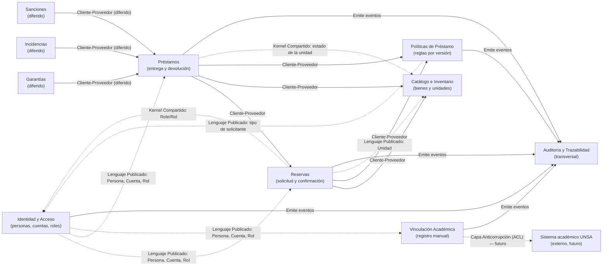

# Bounded Contexts y Mapa de Contexto

Este documento delimita el dominio del **Sistema de Préstamos EPCC** en *bounded
contexts* (contextos acotados) según el diseño dirigido por el dominio (DDD). Cada
contexto define un límite dentro del cual un modelo, su lenguaje y sus invariantes
son coherentes; entre contextos, los mismos términos pueden significar cosas
distintas.

> **Estado de implementación.** Hoy el sistema es un *monolito modular*: todos los
> contextos comparten una única API FastAPI, una única base PostgreSQL
> (`epcc_prestamos`) y transacciones SQLAlchemy. La separación actual es **técnica**
> (capas `api / application / infrastructure`), no física por contextos. Los límites
> que aquí se describen son **lógicos** y sirven de guía para evolucionar hacia
> módulos independientes sin romper el contrato HTTP ni el esquema actual.

---

## 1. Criterios para delimitar los contextos

Se aplicaron cuatro criterios:

1. **Lenguaje ubicuo distinto.** Un término cambia de significado según el contexto
   (p. ej., *"reserva"* para la solicitud y el registro confirmado; *"bien"* para el
   catálogo y para la unidad física).
2. **Invariantes transaccionales.** Las reglas que deben validarse y guardarse juntas
   (confirmar reserva y bloquear unidad; entregar y marcar préstamo) viven en el
   mismo contexto.
3. **Dueño del dato y de la decisión.** Quién cambia el estado de qué (el inventario
   es dueño del estado de la unidad; las políticas son dueñas de la regla vigente).
4. **Ciclo de vida y cadencia de cambio.** Los catálogos cambian lento; las reservas
   y préstamos cambian rápido; las políticas se publican por versiones; la
   vinculación académica depende de sistemas externos.

---

## 2. Mapa de contexto (resumen)

La flecha va del **consumidor (downstream)** hacia el **proveedor (upstream)** y se
etiqueta con el patrón de integración.

### Tabla de relaciones

| Proveedor (upstream) | Consumidor (downstream) | Patrón | Qué comparte |
| --- | --- | --- | --- |
| Identidad y Acceso | Reservas, Préstamos, Vinculación Académica | Lenguaje Publicado / Conformista | `Persona`, `Cuenta`, `Rol`, `Solicitante` |
| Catálogo e Inventario | Reservas, Préstamos | Cliente-Proveedor | `UnidadFisica`, disponibilidad, código de inventario |
| Políticas de Préstamo | Reservas, Préstamos | Cliente-Proveedor | versión vigente aplicable a rol + tipo de bien |
| Reservas | Préstamos | Cliente-Proveedor | reserva confirmada → origen del préstamo |
| Catálogo e Inventario ↔ Reservas ↔ Préstamos | (entre los tres) | Kernel Compartido | `UnitState` (estado de la unidad física) |
| Identidad y Acceso ↔ Políticas | (entre ambos) | Kernel Compartido | enum `Role` como `tipo_solicitante` |
| Préstamos | Garantías / Incidencias / Sanciones | Cliente-Proveedor (diferido) | `prestamo` como origen |
| Vinculación Académica | Sistema UNSA | Capa Anticorrupción (futuro) | matrícula / situación académica |
| Todos | Auditoría y Trazabilidad | Lenguaje Publicado | evento de auditoría con actor, entidad y resultado |

---

## 3. Fichas de los bounded contexts

### 3.1 Identidad y Acceso (Usuarios)

**Tipo:** subdominio de soporte (con roles específicos del dominio). **Estado:** activo.

| Aspecto | Detalle |
| --- | --- |
| Propósito | Registrar personas y cuentas, autenticar, autorizar por rol y desactivar. |
| Lenguaje ubicuo | *persona, cuenta, solicitante, administrador, estudiante, docente, personal administrativo, rol, sesión, estado activo/inactivo*. |
| Agregados | `Persona` (raíz) con `Cuenta`, `Solicitante`, perfil (`Estudiante`, `Docente`, `PersonalAdministrativo`) y atribución `Administrador`. |
| Value objects | `full_name` (calculado), `Role`, `PersonState` (`ACTIVA`/`INACTIVA`). |
| Invariantes | Códigos de cuenta e inventario únicos; documento, correo y usuario únicos; contraseña 12–128; `fecha_fin > fecha_inicio`; una cuenta por persona; un solicitante por persona/cuenta. |
| Reglas | Solo personas con persona y cuenta activas operan; ser administrador no reemplaza el rol personal; los estudiantes no reciben atribución de administrador. |
| Tablas | `persona`, `cuenta`, `solicitante`, `administrador`, `solicitante_estudiante`, `solicitante_docente`, `solicitante_personal_administrativo`. |
| Código | `app/core/security.py`, `app/application/basic_use_cases.py` (`create_person`, desactivación), rutas `people` y `auth` en `app/api/routes.py`. |

### 3.2 Catálogo e Inventario

**Tipo:** subdominio núcleo. **Estado:** activo.

| Aspecto | Detalle |
| --- | --- |
| Propósito | Clasificar bienes y administrar ejemplares físicos identificados individualmente. |
| Lenguaje ubicuo | *tipo de bien, categoría, bien, ficha, unidad física, código de inventario, ubicación, responsable de custodia, accesorios, estado de la unidad*. |
| Agregados | `TipoDeBien` → `CategoriaDelBien` → `Bien`/`FichaDeBien` → `UnidadFisica`. La `FichaDeBien` es raíz del ejemplar; la `UnidadFisica` es el agregado operativo. |
| Value objects | `UnitState` (`DISPONIBLE`, `PRESTADA`, `MANTENIMIENTO`, `BAJA`), `accessories` (JSON), código de inventario. |
| Invariantes | Jerarquía **tipo → categoría → bien/ficha → unidad**; cada ficha identifica una sola unidad (relación 1:1); código de inventario y número de serie únicos; registrar una ficha crea su `bien`; registrar una unidad crea su primera `ubicacion_del_bien`. |
| Reglas | Solo unidades **disponibles, prestables y activas** (ficha/categoría/tipo activos) admiten reserva y entrega. |
| Tablas | `tipo_de_bien`, `categoria_del_bien`, `bien`, `ficha_de_bien`, `unidad_fisica`, `caracteristica_del_bien`, `ubicacion_del_bien`. |
| Código | `app/application/basic_use_cases.py` (`new_item_type`, `new_category`, `new_item`, `new_unit`), rutas `inventory/*` en `app/api/routes.py`. |

### 3.3 Políticas de Préstamo

**Tipo:** subdominio núcleo (motor de reglas versionado). **Estado:** activo.

| Aspecto | Detalle |
| --- | --- |
| Propósito | Publicar y conservar por versiones las reglas de préstamo; proveer la **versión vigente** aplicable a una fecha, rol y tipo de bien. |
| Lenguaje ubicuo | *política, regla, versión, vigencia, cantidad máxima de bienes, duración máxima, modalidad, prórroga, rol/tipo de solicitante*. |
| Agregados | `PoliticaDelPrestamo` (raíz) con sus `VersionDeLaPolitica` y `ReglasDelPrestamo` asociadas. |
| Value objects | contenido de versión (JSON), `TimeUnit` (`HORAS`/`DIAS`), `Role` como `tipo_solicitante`. |
| Invariantes | Publicar escribe política + reglas + versión **en la misma transacción**; una versión nueva conserva el historial; la versión vigente se resuelve por fecha de inicio; `cantidad_maxima_bienes >= 1`, `tiempo_maximo_prestamo > 0`. |
| Reglas (las siete) | 1) solo estudiantes/docentes activos solicitan; 2) unidad disponible y tipo prestable; 3) máx. **2 bienes simultáneos por persona/tipo**; 4) **3 días** estudiante / **7 días** docente; 5) sin cruces de horario por unidad; 6) solo administrador confirma y no su propia reserva; 7) cancelación controlada por titular/administrador. |
| Tablas | `politicas_del_prestamo`, `reglas_del_prestamo`, `version_de_la_politica`. |
| Código | `app/application/politicas.py`, `app/infrastructure/semillas_politicas.py`, `app/core/reglas.py`, rutas `policies*` en `app/api/modulos.py`. |

### 3.4 Reservas

**Tipo:** subdominio núcleo. **Estado:** activo.

| Aspecto | Detalle |
| --- | --- |
| Propósito | Solicitar, confirmar, rechazar y cancelar reservas de una unidad en un intervalo. |
| Lenguaje ubicuo | *solicitud de reserva, registro de reserva, estado (pendiente/confirmada/rechazada/cancelada/atendida/vencida), intervalo, motivo de decisión*. |
| Agregados | `SolicitudDeReserva` (raíz) con su `RegistroDeReserva` (se crea al confirmar). |
| Value objects | intervalo `[inicio, fin)` (semiabierto), `ReservationState`. |
| Invariantes | Inicio futuro y fin posterior al inicio; dos intervalos se solapan si `inicio1 < fin2 ∧ inicio2 < fin1`; confirmar **bloquea la unidad y revalida** estado y conflictos en la misma transacción; confirmar crea el `registro_de_reserva`; confirmar/rechazar exige motivo en rechazo; cancelar actualiza solicitud y registro. |
| Reglas | Se valida al solicitar y otra vez al confirmar; una reserva confirmada conserva en auditoría la versión de política aplicada; las pendientes no ocupan cupo ni bloquean inventario. |
| Tablas | `solicitud_de_reserva`, `registro_de_reserva`, `estado_de_la_reserva`. |
| Código | `app/application/basic_use_cases.py` (`create_reservation`, `decide_reservation`, `cancel_reservation`), rutas `reservations*` en `app/api/routes.py`. |

### 3.5 Préstamos (Circulación: entrega y devolución)

**Tipo:** subdominio núcleo. **Estado:** activo (entrega y devolución; **prórroga diferida**).

| Aspecto | Detalle |
| --- | --- |
| Propósito | Entregar la unidad de una reserva confirmada y registrar su devolución, cerrando el ciclo de circulación. |
| Lenguaje ubicuo | *préstamo, entrega, devolución, vencimiento, modalidad de uso (en sitio/retiro), acta de entrega, condición, accesorios, destino de la unidad, préstamo vencido*. |
| Agregados | `Prestamo` (raíz) con `EntregaDelPrestamo`, `DevolucionDelPrestamo`, `PrestamoAprobadoDeReserva`, `RegistroBienesFisicosPrestamo` y `AmpliacionDevolucionPrestamo` (diferida). |
| Value objects | `LoanState` (`ACTIVO`, `VENCIDO`, `DEVUELTO`, `CERRADO_POR_PERDIDA`), `UseMode`, fechas UTC. |
| Invariantes | Entrega exige reserva **confirmada y no atendida**, dentro de su horario; vencimiento futuro y no superior al fin de la reserva; entrega marca unidad `PRESTADA` y reserva `ATENDIDA`; devolución exige hora real no futura ni anterior a la entrega y no permite devolver dos veces; solo un préstamo abierto por unidad (índice único). |
| Reglas | Entregar más tarde **no reinicia** el plazo; un préstamo fuera de plazo se muestra `VENCIDO` pero no genera multas; la política aplicada se conserva en el préstamo. |
| Tablas | `prestamo`, `prestamo_aprobado_de_reserva`, `entrega_del_prestamo`, `devolucion_del_prestamo`, `registro_bienes_fisicos_prestamo`, `estado_del_prestamo`, `ampliacion_devolucion_prestamo`. |
| Código | `app/application/prestamos.py`, rutas `loans*` en `app/api/modulos.py`. |

### 3.6 Vinculación Académica

**Tipo:** subdominio de soporte (integración). **Estado:** activo solo en modo manual.

| Aspecto | Detalle |
| --- | --- |
| Propósito | Registrar manualmente períodos, información académica y matrículas de estudiantes. |
| Lenguaje ubicuo | *semestre/período, información académica, matrícula, situación, promedio, créditos (aprobados/reprobados/cursando), fecha de verificación*. |
| Agregados | `SemestreAcademico`, `InformacionEstudiante` (raíz), `MatriculaRealizada`. |
| Value objects | situación (`MATRICULADO`, `NO_MATRICULADO`, `EGRESADO`, …), promedio `Decimal`, créditos. |
| Invariantes | `fecha_fin > fecha_inicio` del período; matrícula única por estudiante + período; información académica única por estudiante; la matrícula y la información académica son registros **separados**. |
| Reglas | Registro manual sin consulta institucional automática; **no** se aplican bloqueos académicos ni se exige promedio/matrícula para reservar. |
| Tablas | `semestre_academico`, `informacion_estudiante`, `matricula_realizada`. |
| Código | `app/application/academico.py`, `app/application/schemas_academicos.py`, rutas `academic/*` en `app/api/modulos.py`. |
| Frontera futura | Se recomienda una **Capa Anticorrupción (ACL)** hacia el sistema de la UNSA para traducir su modelo a `matricula`/`informacion_estudiante` sin contaminar el lenguaje propio. |

### 3.7 Auditoría y Trazabilidad

**Tipo:** subdominio genérico transversal (kernel compartido). **Estado:** activo.

| Aspecto | Detalle |
| --- | --- |
| Propósito | Registrar operaciones relevantes con su actor, entidad afectada, resultado y fecha; conservar el historial de cambios. |
| Lenguaje ubicuo | *evento de auditoría, tipo de evento, actor, entidad, resultado, historial de cambios*. |
| Agregados | `RegistroAuditoria` (raíz) con `HistorialDeCambios` y `TipoDeEvento`. |
| Invariantes | El actor es una **cuenta** (no una persona) y puede ser nulo para procesos automáticos; auditoría y decisión crítica se guardan **en la misma transacción**; la versión de política aplicada queda registrada en la auditoría. |
| Tablas | `registro_auditoria`, `historial_de_cambios`, `tipo_de_evento`. |
| Código | `app/application/comun.py` (`audit`), usado por todos los casos de uso. |

### 3.8 Contextos diferidos (diseñados, no operativos)

Las tablas existen en PostgreSQL, pero **no** se han habilitado sus procesos ni rutas
HTTP. Se modelan como contextos separados para que, al activarse, no contaminen los
contextos núcleo.

| Contexto | Tablas | Relación propuesta |
| --- | --- | --- |
| **Garantías** | `tipo_de_garantia`, `estado_de_la_garantia`, `garantia` | Cliente-Proveedor desde Préstamos (una garantía exige un `prestamo`). |
| **Incidencias** | `tipo_de_incidencia`, `estado_de_la_incidencia`, `incidencia`, `resolucion_de_incidencia` | Cliente-Proveedor desde Préstamos y desde Identidad (`solicitante`, `administrador`). |
| **Sanciones** | `tipo_de_sancion`, `estado_de_la_sancion`, `sancion`, `cumplimiento_de_sancion`, `apelacion_de_sancion` | Cliente-Proveedor desde Préstamos (una sanción exige un `prestamo`). |
| **Prórrogas** (dentro de Préstamos) | `ampliacion_devolucion_prestamo` | Parte del agregado `Prestamo`, aún sin rutas. |

---

## 4. Correspondencia entre tablas y contextos

Las 45 tablas quedan asignadas así:

| Contexto | Tablas |
| --- | --- |
| Identidad y Acceso | `persona`, `cuenta`, `solicitante`, `administrador`, `solicitante_estudiante`, `solicitante_docente`, `solicitante_personal_administrativo` |
| Catálogo e Inventario | `tipo_de_bien`, `categoria_del_bien`, `bien`, `ficha_de_bien`, `unidad_fisica`, `caracteristica_del_bien`, `ubicacion_del_bien` |
| Políticas de Préstamo | `politicas_del_prestamo`, `reglas_del_prestamo`, `version_de_la_politica` |
| Reservas | `solicitud_de_reserva`, `registro_de_reserva`, `estado_de_la_reserva` |
| Préstamos | `prestamo`, `prestamo_aprobado_de_reserva`, `entrega_del_prestamo`, `devolucion_del_prestamo`, `registro_bienes_fisicos_prestamo`, `estado_del_prestamo`, `ampliacion_devolucion_prestamo` |
| Vinculación Académica | `semestre_academico`, `informacion_estudiante`, `matricula_realizada` |
| Auditoría y Trazabilidad | `registro_auditoria`, `historial_de_cambios`, `tipo_de_evento` |
| Garantías (diferido) | `tipo_de_garantia`, `estado_de_la_garantia`, `garantia` |
| Incidencias (diferido) | `tipo_de_incidencia`, `estado_de_la_incidencia`, `incidencia`, `resolucion_de_incidencia` |
| Sanciones (diferido) | `tipo_de_sancion`, `estado_de_la_sancion`, `sancion`, `cumplimiento_de_sancion`, `apelacion_de_sancion` |

---

## 5. Correspondencia con el código

| Contexto | Capa application | Capa api | Infraestructura |
| --- | --- | --- | --- |
| Identidad y Acceso | `basic_use_cases.py` (personas/desactivación), `core/security.py` | `routes.py` (`auth`, `people`) | `models.py` |
| Catálogo e Inventario | `basic_use_cases.py` (catálogo/inventario) | `routes.py` (`inventory/*`) | `models.py`, `modelos_sql.py` |
| Políticas de Préstamo | `politicas.py`, `semillas_politicas.py`, `core/reglas.py` | `modulos.py` (`policies*`) | `models.py`, `modelos_sql.py` |
| Reservas | `basic_use_cases.py` (reservas) | `routes.py` (`reservations*`) | `models.py`, `modelos_sql.py` |
| Préstamos | `prestamos.py` | `modulos.py` (`loans*`) | `models.py`, `modelos_sql.py` |
| Vinculación Académica | `academico.py`, `schemas_academicos.py` | `modulos.py` (`academic/*`) | `models.py`, `modelos_sql.py` |
| Auditoría | `comun.py` (`audit`, `UseCaseError`, fechas UTC) | (transversal) | `models.py`, `modelos_sql.py` |

---

## 6. Observaciones y evolución recomendada

1. **Hoy es un monolito con una sola base.** Los contextos comparten una API, una
   PostgreSQL y transacciones SQLAlchemy. El acoplamiento real es vía **tablas
   compartidas y el kernel de enums/estados** (`Role`, `UnitState`, `LoanState`,
   `ReservationState`), no vía contratos entre módulos.
2. **Kernel compartido a estabilizar.** El `UnitState` es un concepto que circula
   entre Inventario, Reservas y Préstamos; debe tener **un único dueño** (Inventario)
   y transiciones explícitas (`DISPONIBLE → PRESTADA → DISPONIBLE/MANTENIMIENTO/BAJA`).
3. **Contratos en los bordes.** Reservas→Préstamos y Políticas→(Reservas/Préstamos)
   son los bordes con más valor: definir qué dato viaja (reserva confirmada,
   versión vigente, política aplicada) evita leer tablas ajenas por claves foráneas.
4. **ACL para la UNSA.** Al habilitar la consulta institucional, aislarla en la
   Vinculación Académica mediante una capa anticorrupción, sin bloquear reservas con
   reglas no acordadas.
5. **Activar diferidos de a uno.** Garantías, Incidencias y Sanciones son
   Cliente-Proveedor de Préstamos; activarlos sin acoplar sus tablas a los casos de
   uso núcleo mantiene los contextos separados.
6. **Nombres y rutas históricas.** Los atributos Python y las rutas HTTP conservan
   nombres en inglés; los nombres físicos en PostgreSQL son españoles. El contrato
   HTTP es el borde externo estable; los contextos no obligan a renombrar nada hoy.
